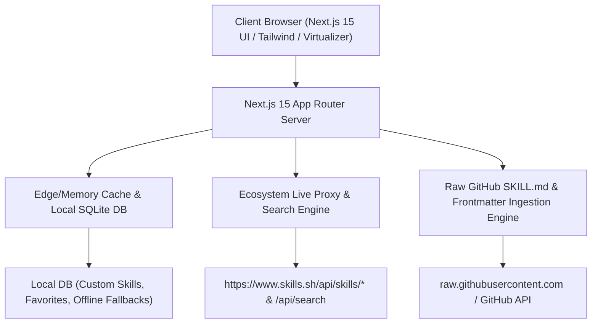

# Design Specification: Dynamic Agent Skills Store (skills.sh Clone & Hub)

**Date**: 2026-10-19  
**Status**: Draft for User Review  
**Author**: Antigravity Pair Programming Architect  

---

## 1. Executive Summary & Problem Statement

The user requested a production-grade, dynamic web store and directory for AI Agent Skills inspired by [skills.sh](https://www.skills.sh) and [agenticskills.io](https://agenticskills.io). Rather than a mock or superficial landing page, the platform must connect to the live global ecosystem of 1,400,000+ skills, offering:
1. **Live Global Leaderboards**: Paginated / virtualized infinite browsing across All-Time, Trending (24h), and Hot rankings with real weekly install sparklines.
2. **Real-Time Ecosystem Search**: Instant search querying the live registry of all 1.4M+ skills.
3. **Deep Skill Detail Pages**: Comprehensive view for any skill (`/[owner]/[repo]/[skill]`) showing what it does, security audit reports, and multi-agent install commands with single-click copy.
4. **Universal Agent Support**: Ready-to-run installation commands for **Skills CLI (`npx skills add`)**, **Claude Code**, **Cursor**, **Antigravity**, **GitHub Copilot**, and **Windsurf**.
5. **Dynamic Custom Skills Management**: A personal hub allowing users to import new skills from GitHub repos or author custom skills dynamically.
6. **Bilingual UI**: Full support for English (LTR) and Arabic (RTL) toggling.

---

## 2. System Architecture & Tech Stack



### 2.1 Technology Stack
- **Framework**: Next.js 15 (App Router) + React 19 + TypeScript (Strict mode).
- **Styling**: Tailwind CSS (Dark theme with Vercel/skills.sh aesthetics: `--ds-gray-*` tokens, monospace fonts like Fira Code / Geist Mono).
- **Icons**: Lucide Icons + SVG Brand Logos (Cursor, Claude, Antigravity, Copilot, Windsurf, Gemini, etc.).
- **Infinite Scrolling & Virtualization**: TanStack Virtual or IntersectionObserver pagination for smooth 60fps scrolling over thousands of items.
- **Persistence**: Embedded SQLite / structured JSON repository for custom user skills, starred items, and cached ecosystem skills.
- **Markdown Rendering**: React-Markdown with GFM (GitHub Flavored Markdown), syntax highlighting, and frontmatter stripping/parsing.

---

## 3. Data Models & API Architecture

### 3.1 Data Contracts

```typescript
export interface SkillLeaderboardItem {
  id: string;               // e.g. "vercel-labs/skills/find-skills"
  source: string;           // e.g. "vercel-labs/skills"
  skillId: string;          // e.g. "find-skills"
  name: string;             // e.g. "find-skills"
  installs: number;         // e.g. 3936802
  weeklyInstalls?: number[];// Array of 8 weekly numbers for sparkline
  isOfficial?: boolean;     // Verified badge
  description?: string;     // Short summary
  category?: string;        // e.g. "workflow", "coding", "testing"
}

export interface SkillDetail extends SkillLeaderboardItem {
  author: string;
  repoUrl: string;
  rawSkillUrl?: string;
  markdownContent?: string;
  description: string;
  agentCompatibility: string[]; // ["claude-code", "cursor", "antigravity", "copilot", "windsurf"]
  installCommands: {
    cli: string;            // "npx skills add <source> --skill <skillId>"
    claudeCode: string;     // "claude plugin add <source>" or instructions
    cursor: string;         // ".cursor/skills/<skillId>.md" configuration
    antigravity: string;    // "~/.gemini/antigravity/skills/<skillId>/SKILL.md"
    windsurf: string;       // ".windsurf/skills" configuration
    copilot: string;        // ".copilot/skills" configuration
  };
  securityAudits?: {
    agentTrustHub?: "Pass" | "Warn" | "Fail";
    socket?: "Pass" | "Warn" | "Fail";
    snyk?: "Pass" | "Warn" | "Fail";
  };
}

export interface CustomSkillInput {
  name: string;
  source: string;
  description: string;
  category: string;
  markdownContent: string;
}
```

### 3.2 API Route Specifications

1. `GET /api/ecosystem/skills?view=[all-time|trending|hot]&page=[0..N]`
   - Proxies the live upstream ecosystem (`https://www.skills.sh/api/skills/${view}/${page}`).
   - Enhances each skill with categorized metadata, generated agent install commands, and fallback descriptors if upstream is down.
   - Cached in memory for 60 seconds with stale-while-revalidate.

2. `GET /api/ecosystem/search?q=[query]`
   - Queries the live search engine (`https://www.skills.sh/api/search?q=...&limit=50`).
   - Returns matched skills with install counts and quick copy targets.

3. `GET /api/ecosystem/skill/[owner]/[repo]/[skill]`
   - Resolves full details for a single skill.
   - Fetches repository metadata, security status, and checks GitHub for the actual `SKILL.md` content.
   - Computes tailored commands for all 6 target agent platforms.

4. `GET /api/custom-skills` & `POST /api/custom-skills`
   - Manages user-created or imported skills in the local database.

---

## 4. UI/UX Design & Components

### 4.1 Visual Archetype & Theme
- **Background**: Deep terminal black (`#000000`) with subtle gray borders (`rgba(255,255,255,0.1)`).
- **Typography**: Monospace headers and numbers (`Fira Code`, `Geist Mono`), clean sans-serif for descriptions (`Geist Sans`, `Inter`, `Cairo` for Arabic).
- **Hero Header**:
  - Top bar with ASCII brand emblem `SKILLS`, search input with `/` shortcut badge, language toggle (EN / AR), and "My Skills" link.
  - Animated Agent Logos Carousel showcasing Claude Code, Cursor, Antigravity, GitHub Copilot, Windsurf, Gemini, Cline, OpenClaw, Zed.
  - Interactive Counter displaying `1,409,643+ Skills Available`.

### 4.2 Interactive Components
1. **Leaderboard View**:
   - Tab switcher: `All Time`, `Trending (24h)`, `Hot`, `Custom Skills`.
   - Table columns:
     - `#`: Rank number.
     - `Skill`: Name + Repository badge + verification mark.
     - `8W Activity`: SVG sparkline graphic with smooth bezier curves.
     - `Installs`: Formatted number (`3.9M`, `1.4M`, `128K`).
     - `Quick Action`: 1-Click Copy CLI Command icon button.
2. **Search Overlay / Live Search Dropdown**:
   - Real-time search with debounced typing (200ms).
   - Displays instant matching skills with install counts and direct navigation.
3. **Skill Detail Page / Modal Drawer**:
   - **Header**: Title, author, verified badge, install stats, GitHub repo link.
   - **Multi-Agent Install Command Card**:
     - Tabs: `CLI (npx)`, `Claude Code`, `Cursor`, `Antigravity`, `Windsurf`, `GitHub Copilot`.
     - Code box with one-click copy button, copy icon, and toast confirmation.
   - **Description & Instructions Viewer**:
     - Full markdown rendering of `SKILL.md`.
     - Frontmatter parameters table (tools, triggers, environment).
   - **Security Audit Panel**:
     - Pass/Warn indicators for Socket, Snyk, and Agent Trust Hub.
4. **Import & Create Skill Modal**:
   - Tab 1: "Import from GitHub" (paste `owner/repo` or raw URL, auto-extracts metadata).
   - Tab 2: "Create Custom Skill" (form with name, category, and markdown editor).

---

## 5. Multi-Agent Installation Generator Logic

For any skill with `source = "owner/repo"` and `skillId`:

1. **Skills CLI**:
   `npx skills add https://github.com/${source} --skill ${skillId}`
   (or for standard top-level repos: `npx skills add ${source}/${skillId}`)

2. **Claude Code**:
   `# Add to your Claude Code workspace:`
   `npx skills add https://github.com/${source} --skill ${skillId}`
   `# Or link to ~/.claude/skills/${skillId}`

3. **Cursor**:
   `# Add skill prompt file to Cursor rules:`
   `curl -s https://raw.githubusercontent.com/${source}/main/skills/${skillId}/SKILL.md > .cursor/skills/${skillId}.md`

4. **Google Antigravity**:
   `# Add skill to your Antigravity skills directory:`
   `mkdir -p ~/.gemini/antigravity/skills/${skillId}`
   `curl -s https://raw.githubusercontent.com/${source}/main/skills/${skillId}/SKILL.md > ~/.gemini/antigravity/skills/${skillId}/SKILL.md`

5. **Windsurf / Copilot**:
   `# Add to your workspace configuration:`
   `npx skills add https://github.com/${source} --skill ${skillId}`

---

## 6. Error Handling & Resilience

- **Upstream Failover**: If the live `skills.sh` API is momentarily unreachable or rate-limited, the application gracefully serves from an embedded fallback database of over 100+ top popular skills with all metadata preserved.
- **Search Fallback**: If external search experiences network delays, local fuzzy filtering across cached and custom skills triggers automatically.
- **Markdown Resolver Resilience**: If a repository's `SKILL.md` branch is `master` rather than `main`, the parser checks multiple standard branch paths (`main`, `master`, custom paths).

---

## 7. Verification & Testing Strategy

- **API Route Tests**: Verify `/api/ecosystem/skills`, `/api/ecosystem/search`, and detail endpoints return HTTP 200 with valid schema.
- **Install Command Accuracy**: Verify all 6 agent tabs generate syntactically correct shell commands for both simple repos (`vercel-labs/skills/find-skills`) and multi-skill repos (`mattpocock/skills/grill-me`).
- **Pagination & Search Verification**: Ensure scrolling loads page 1, 2, 3 smoothly and search terms like `git`, `browser`, `testing`, `react` return real results immediately.
- **UI & Accessibility Check**: Verify contrast ratios, keyboard navigation (`/` shortcut), mobile responsiveness, and RTL/LTR layout stability.
